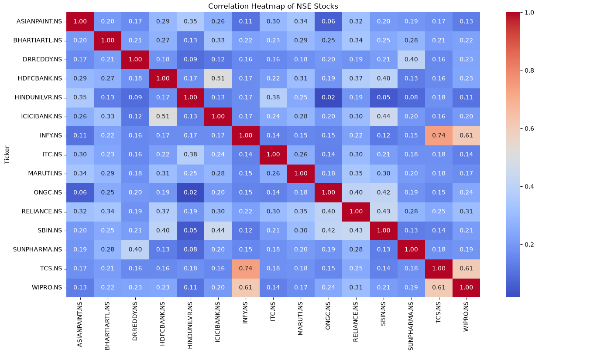
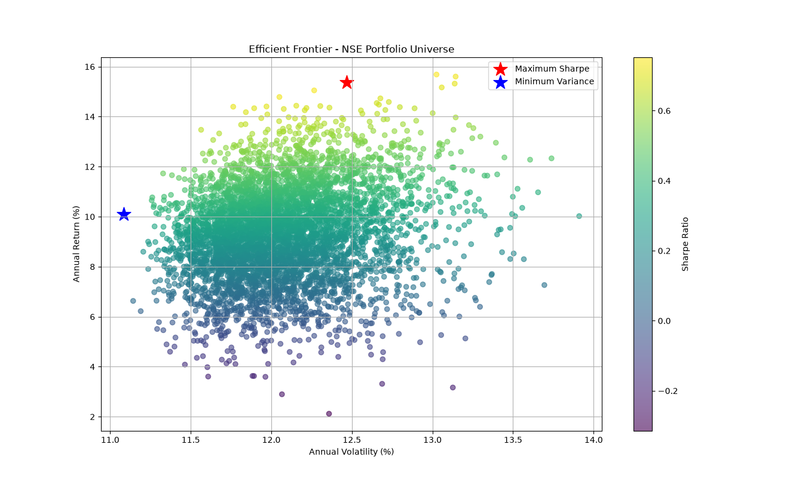
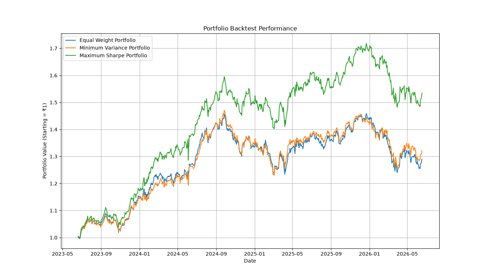

# Multi-Asset Portfolio Risk Analyzer

A quantitative finance project built in Python to analyze portfolio risk, diversification, asset allocation, and risk-adjusted performance across 15 NSE-listed equities. The project applies **Modern Portfolio Theory (MPT), Monte Carlo simulation, and rolling out-of-sample backtesting** to compare portfolio construction strategies under different transaction-cost assumptions.

## Project Overview

- **Project:** Multi-Asset Portfolio Risk Analyzer
- **Market Data Period:** 18 October 2021 – 16 October 2026
- **Data Source:** Yahoo Finance via `yfinance`
- **Asset Universe:** 15 NSE-listed equities
- **Optimization Method:** Monte Carlo simulation
- **Number of Simulated Portfolios:** 5,000
- **Backtesting Approach:** Rolling out-of-sample evaluation
- **Baseline Transaction Cost:** 10 basis points
- **Primary Language:** Python

## Project Highlights

- Collected and processed historical daily price data for 15 NSE-listed equities.
- Calculated annualized returns, volatility, Sharpe Ratio, Sortino Ratio, historical Value at Risk (VaR), and Maximum Drawdown.
- Simulated 5,000 long-only portfolio allocations using Monte Carlo methods.
- Constructed Equal Weight, Maximum Sharpe, and Minimum Variance portfolios.
- Visualized the Efficient Frontier and asset correlation structure.
- Evaluated portfolio strategies using rolling out-of-sample backtesting.
- Incorporated transaction costs into portfolio performance calculations.
- Conducted transaction-cost sensitivity analysis at 5, 10, 25, and 50 basis points.
- Compared portfolio strategies against the Nifty 50 price-index benchmark.

## Methodology

### 1. Market Data Collection

Historical market data is retrieved from Yahoo Finance using `yfinance`. The analysis covers 15 selected NSE-listed equities across banking, information technology, energy, FMCG, healthcare, telecommunications, automobiles, and consumer-related sectors.

Adjusted price data is used through `yfinance` with `auto_adjust=True`.

### 2. Return and Risk Calculation

Daily returns are calculated from historical prices. The project uses these returns to estimate portfolio performance and risk.

The annualization convention is based on **252 trading days per year**, with an assumed annual risk-free rate of **6%**.

### 3. Monte Carlo Portfolio Simulation

The project generates 5,000 random long-only portfolio allocations using randomly sampled portfolio weights.

For each simulated portfolio, the model calculates annualized return, annualized volatility, and Sharpe Ratio. The resulting portfolio statistics are used to construct the Efficient Frontier and select portfolio allocations.

Three strategies are evaluated:

- **Equal Weight Portfolio:** Allocates equal capital weights across the selected assets.
- **Maximum Sharpe Portfolio:** Selects the simulated portfolio with the highest estimated Sharpe Ratio.
- **Minimum Variance Portfolio:** Selects the simulated portfolio with the lowest estimated volatility.

### 4. Rolling Out-of-Sample Backtesting

The backtest evaluates portfolio strategies over sequential test periods rather than relying only on performance measured over the full historical dataset.

The main configuration uses:

- Training window: 252 daily return observations
- Rebalancing interval: 21 daily return observations
- Transaction-cost assumption: 10 basis points
- Benchmark: Nifty 50 price index

Portfolio weights are estimated using the training window and evaluated on subsequent out-of-sample observations. Portfolio holdings drift with asset returns between rebalancing dates.

The backtest records daily portfolio returns and calculates cumulative performance and risk metrics.

### 5. Transaction-Cost Sensitivity Analysis

To examine the effect of trading costs on portfolio performance, the backtest is repeated using four transaction-cost assumptions:

- 5 basis points
- 10 basis points
- 25 basis points
- 50 basis points

The sensitivity analysis compares how portfolio CAGR and Sharpe Ratio change as assumed transaction costs increase.

These costs are model assumptions rather than live brokerage quotes.

## Key Out-of-Sample Results

The following results correspond to the latest baseline run using a 10-basis-point transaction-cost assumption.

| Strategy | Total Return | CAGR | Annualized Volatility | Sharpe Ratio | Sortino Ratio | Maximum Drawdown |
|---|---:|---:|---:|---:|---:|---:|
| Equal Weight | 33.38% | 7.67% | 11.34% | 0.195 | 0.278 | -19.96% |
| Maximum Sharpe | 43.45% | 9.70% | 13.79% | 0.318 | 0.447 | -26.68% |
| Minimum Variance | 38.34% | 8.68% | 10.70% | 0.287 | 0.412 | -21.45% |
| Nifty 50 Price Index | 31.54% | 7.29% | 12.60% | 0.159 | 0.222 | -15.77% |

**Evaluation period:** 24 October 2022 – 16 October 2026  
**Out-of-sample observations:** 982 daily observations

### Performance Interpretation

- The Maximum Sharpe Portfolio recorded the highest total return and CAGR among the three portfolio strategies in this backtest.
- The Minimum Variance Portfolio had the lowest annualized volatility among the three portfolio strategies.
- The Maximum Sharpe Portfolio also experienced the largest maximum drawdown among the three portfolio strategies.
- The Nifty 50 price-index benchmark had a lower total return than the three strategies but recorded the smallest maximum drawdown.

These results are historical and do not guarantee future performance. Results depend on the selected asset universe, estimation windows, optimization method, and transaction-cost assumptions.

## Transaction-Cost Sensitivity

The following table presents the Maximum Sharpe Portfolio's results under different transaction-cost assumptions.

| Transaction Cost | CAGR | Sharpe Ratio |
|---|---:|---:|
| 5 bps | 9.89% | 0.331 |
| 10 bps | 9.70% | 0.318 |
| 25 bps | 9.13% | 0.280 |
| 50 bps | 8.17% | 0.216 |

The results show declining CAGR and Sharpe Ratio as assumed transaction costs increase. This analysis illustrates why trading costs matter when evaluating strategies that periodically rebalance portfolio allocations.

## Risk Metrics Implemented

| Metric | Purpose |
|---|---|
| Annualized Arithmetic Return | Annualizes the average daily return using the 252-trading-day convention. |
| CAGR | Measures the annualized compound growth rate over the evaluation period. |
| Annualized Volatility | Measures the standard deviation of daily returns, annualized using the square root of 252. |
| Sharpe Ratio | Measures excess return relative to total volatility using the assumed risk-free rate. |
| Sortino Ratio | Measures excess return relative to downside deviation. |
| Historical VaR (95%) | Estimates a daily loss threshold from the historical return distribution at the 95% confidence level. |
| Maximum Drawdown | Measures the largest peak-to-trough decline in portfolio value. |

## Visualizations

The project generates visualizations to help interpret portfolio structure, diversification, and historical performance.

### Correlation Heatmap

Shows correlations between the selected equities and helps identify potential diversification relationships.



### Efficient Frontier

Displays the risk-return characteristics of the simulated portfolios, including the selected Maximum Sharpe and Minimum Variance portfolios.



### Maximum Sharpe Portfolio Allocation

Visualizes the asset weights selected for the Maximum Sharpe Portfolio.


### Minimum Variance Portfolio Allocation

Visualizes the asset weights selected for the Minimum Variance Portfolio.


### Rolling Out-of-Sample Backtest

Compares cumulative portfolio performance over the out-of-sample evaluation period.



### Transaction-Cost Sensitivity

The sensitivity analysis generates additional charts and a CSV summary under the `outputs/` directory. Include the generated sensitivity charts in `screenshots/` if you want to embed them in this section.

## Dataset

**Source:** Yahoo Finance via `yfinance`  
**Frequency:** Daily  
**Price history:** 18 October 2021 – 16 October 2026  
**Assets:** 15 NSE-listed equities plus the Nifty 50 price-index benchmark

### Asset Universe

1. Reliance Industries
2. Tata Consultancy Services
3. Infosys
4. HDFC Bank
5. ICICI Bank
6. State Bank of India
7. ITC
8. Hindustan Unilever
9. Sun Pharmaceutical Industries
10. Dr. Reddy's Laboratories
11. Asian Paints
12. Maruti Suzuki
13. Bharti Airtel
14. ONGC
15. Wipro

The asset universe is fixed for this analysis. The results may therefore be affected by selection bias and survivorship bias. The Nifty 50 benchmark used here is a price index rather than a total-return index.

## Technology Stack

- **Python** — Core implementation
- **Pandas** — Data manipulation and time-series analysis
- **NumPy** — Numerical calculations and portfolio simulation
- **Matplotlib** — Charts and performance visualizations
- **Seaborn** — Correlation heatmap
- **yfinance** — Historical market data retrieval
- **SciPy** — Scientific computing

## Concepts Demonstrated

- Modern Portfolio Theory
- Monte Carlo Simulation
- Portfolio Optimization
- Efficient Frontier Construction
- Quantitative Risk Analysis
- Risk-Adjusted Performance Measurement
- Diversification Analysis
- Rolling Out-of-Sample Backtesting
- Transaction-Cost Modeling
- Sensitivity Analysis
- Financial Data Analysis

## Repository Structure

The following illustrates the intended repository organization. Keep it synchronized with the files actually committed to GitHub.

```text
Multi-Asset-Portfolio-Risk-Analyzer/
├── main_upgraded_with_sensitivity.py
├── main_upgraded.py
├── main.py
├── methodology_notes.md
├── requirements.txt
├── README.md
├── .gitignore
├── screenshots/
│   ├── correlation_heatmap.png
│   ├── efficient_frontier.png
│   ├── max_sharpe_allocation.png
│   ├── min_variance_allocation.png
│   └── portfolio_backtest.png
└── outputs/
    ├── rolling_backtest_summary.csv
    ├── transaction_cost_sensitivity.csv
    └── other generated outputs
```

Generated filenames may vary according to the implementation. The virtual environment directory (`venv/`) should remain local and should not be committed.

## Installation and Usage

### Prerequisites

- Python 3.10 or later recommended
- Git
- Internet connection for downloading historical market data

### 1. Clone the repository

```bash
git clone https://github.com/Lakshya837/Multi-Asset-Portfolio-Risk-Analyzer.git
cd Multi-Asset-Portfolio-Risk-Analyzer
```

### 2. Create and activate a virtual environment

**macOS / Linux**

```bash
python3 -m venv venv
source venv/bin/activate
```

**Windows**

```bash
python -m venv venv
venv\Scripts\activate
```

### 3. Install dependencies

```bash
pip install -r requirements.txt
```

### 4. Run the analysis

Run the sensitivity-enabled implementation:

```bash
python main_upgraded_with_sensitivity.py
```

The script downloads historical data, performs portfolio simulation and rolling backtesting, calculates performance metrics, and generates output files and visualizations.

The actual entry point and output filenames should match the version committed to the repository.

## Limitations

- **Fixed asset universe:** The selected 15 equities may introduce selection and survivorship bias.
- **Benchmark limitation:** The Nifty 50 price index does not include dividends in the way a total-return index does.
- **Parameter estimation:** Expected returns and covariance estimates can be unstable and sensitive to the training window.
- **Simulation limitation:** Monte Carlo optimization evaluates randomly generated allocations and does not guarantee a globally optimal portfolio.
- **Transaction costs:** The model uses simplified basis-point assumptions rather than instrument-specific brokerage, taxes, slippage, or market impact.
- **Risk-free rate:** A fixed annual risk-free rate of 6% is assumed.
- **Historical performance:** Backtested results are not a guarantee of future returns.
- **Data availability:** Results depend on the quality and availability of historical data retrieved from Yahoo Finance.

## Future Improvements

- Compare against a Nifty 50 total-return benchmark.
- Test alternative rolling-window lengths and rebalancing frequencies.
- Incorporate more realistic brokerage, taxes, slippage, and market-impact assumptions.
- Add Conditional Value at Risk (CVaR).
- Evaluate factor-based portfolio strategies.
- Investigate Black-Litterman portfolio optimization.
- Develop an interactive dashboard using Streamlit.

## Author

**Lakshya Kumar**  
B.Tech, VLSI Design and Technology  
National Institute of Technology Delhi

GitHub: [Lakshya837](https://github.com/Lakshya837)
